# agentic-forecast-review — Ground Zero

*Project plan, 31 October 2026. Design stage: nothing is built and no results exist yet.
Printable version: [ground-zero.pdf](ground-zero.pdf).*

> **How to read this.** Plain text is the design. **[SPECULATION]** marks estimates,
> illustrative examples and unproven benefits. **[FINDING]** marks outside facts with a
> source (see [References](#references)). Terms are defined in the [Glossary](#glossary).
>
> **Diagram colours:** blue = code (deterministic, tested) · amber = model (bounded choice) ·
> green = human or valid outcome · red = failure or out of scope · purple = gate, freeze or
> hidden ground truth.

## The project in one paragraph

After a forecast cycle closes and actual sales arrive, an analyst has to work out which
forecasts got worse, whether the data behind the comparison can be trusted, and whether a
miss is real and where it sits. This project builds a read-only agent that does that
investigation with five small, tested tools, then hands the analyst an evidence packet:
what was checked, what was found, which source rows prove it, and what is still unknown.
The agent never forecasts, never does arithmetic, and never changes anything. A
well-written Python script gets the same tools and the same cases, and the two are scored
side by side. If the script turns out just as good, that is a valid result and it gets
published.

### The core decisions

| | |
|---|---|
| **What is built** | One agent (Google ADK, model via OpenRouter), five typed read-only tools, an evidence packet, and an offline evaluation with replay. |
| **What it is compared with** | A reasonable scripted Python report using the same tools, with no call limit. It is frozen before any held-out test case exists. |
| **Data** | Synthetic fixtures with planted defects. Public retail data (M5) only as an optional extra at the end. |
| **Numbers** | The model writes pointer tokens; code fills in every number. A validator rejects stray digits in free text. |
| **Kill gate** | Weekend 3: two matched cases must lead to different investigations because their evidence differs, or the premise is revised. |
| **Time and money** | Seven weekends, 58–72 planned hours plus 8–10 contingency; $60 model cap, $15 optional hosting. |
| **Freeze** | No re-planning before 30 Nov 2026. New ideas go to a parking-lot file. |

---

## 1. The problem and the goal

When actual sales come in, one error number per series is easy to produce and easy to
misread. An increase in error might mean the model got worse. It might also mean records
are missing, two model versions are being compared, or the horizons don't match. A good
review assembles the right comparisons, checks the data where something looks off, and
keeps what was observed apart from what is only suspected.

**[SPECULATION]** That assembly work is where an agent might help. Whether this is a
recurring pain in real teams has not been checked.

> **The request the system must handle.** "Which store-category forecasts need review this
> period? Check whether the apparent deterioration is a data issue or a consistent
> forecasting miss, show the evidence, and tell me what remains uncertain."

A useful answer names the relevant series and dates; confirms that the comparisons use
compatible models and horizons; inspects data quality where warranted; and separates an
observed pattern from an unproven explanation. The ranking rule is fixed: rank increases in
MAE within matched series and windows, and flag incomparable data separately. The agent may
not invent priority weights or treat the largest unit error as the largest business risk.

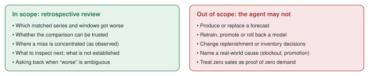

*Figure 1 · Task boundary. "Underforecasting is concentrated in this window" can be shown
by comparison. "A promotion caused it" needs evidence this project does not have. Any
action stays with a human.*

### The goal

Build an inspectable demonstration of agent engineering — tool design, state,
evidence-dependent control flow, budgets, failure handling, tracing, replay and honest
evaluation — in a domain you already know. The question it answers: **can the agent decide
what to inspect next, use the right inputs, recognise when the evidence is insufficient,
and finish within a budget, and is that worth more than a good script?**

- **Where the agent might add value — [SPECULATION]:** differently worded requests;
  picking a narrower next query; following up on an unexpected result; asking for missing
  scope; stitching several tools into one investigation. These are hypotheses to test, not
  benefits to claim.
- **What it will not prove:** production adoption, inventory savings, better demand
  forecasts, autonomous root-cause diagnosis, a new architecture, or more interview
  callbacks. If the workflow is fully fixed, a script may be as good or better, and the
  project says so.

## 2. The solution at a glance

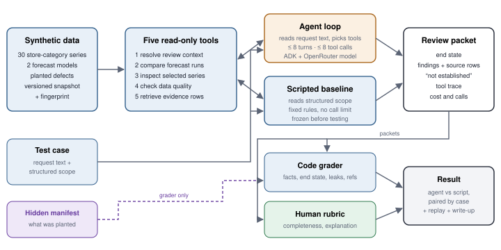

*Figure 2 · System at a glance. The agent and the script share the same data, tools and
packet format; only how they decide what to check differs. The manifest that says what was
planted is visible to the grader only.*

### Five principles that hold everywhere

1. **Code owns arithmetic.** Metrics, comparisons, data checks and every number shown are
   ordinary tested Python.
2. **The model owns bounded choices.** Which tool next, with which arguments; when to follow
   up, ask back or stop; how to explain.
3. **Evidence or nothing.** Every finding links to the exact source rows. Anything unproven
   goes under "not established".
4. **Honest exits.** When the budget runs out or a tool fails, the packet says it is
   incomplete rather than guessing.
5. **A fair comparison.** The script is good, not a straw man, and is frozen before the test
   cases it is scored on exist.

### Why this fits you

**[FINDING — supplied]** You work with production forecasting and analytical LLM pipelines,
and cannot expose employer data. Forecasting gives you familiar, checkable evidence; the
agent gives the engineering question. Agent-harness roles name exactly these skills (loops,
tool execution, tracing, replay, evaluations). This is applying known patterns well, not
inventing a new kind of agent.

## 3. Architecture

One agent, not a team of agents. It has five *typed* read-only tools — the arguments and
returned fields have an explicit format that code checks. The agent loop runs on Google
ADK, which handles the tool calls and tracing; the model is reached through OpenRouter
using ADK's LiteLLM support, so the existing OpenRouter key setup carries over. ADK is
chosen because you know it, not because it is proven best.

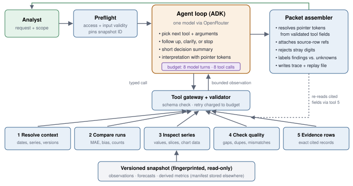

*Figure 3 · System boundary. Blue boxes are deterministic, tested Python. The amber loop
chooses tools and writes interpretation; it never computes a number that is shown. The
packet goes back to the analyst (green arrow, top).*

| Tool | Code returns | Agent decides |
|---|---|---|
| 1 Resolve review context | Available dates, series, model versions, metric definitions, snapshot identity | Is the request clear enough, or ask back? |
| 2 Compare forecast runs | Error and bias by series, model and window, with record counts | Which comparison matters; which group needs a closer look |
| 3 Inspect selected series | Historical values, forecasts, recent-window summaries, chart data | Which series, window or view to look at next |
| 4 Check data quality | Missing dates, duplicates, record coverage, incompatible fields | Whether a suspicious comparison needs deeper checks, and whether to stop |
| 5 Retrieve evidence rows | The exact records behind cited findings, each with a stable row ID | Which records support the final conclusions |

Preflight checks access and input validity only. It must not run the investigation itself
and leave the model to narrate the result.

## 4. Control flow

The visible record shows tool names, arguments, results and short decision summaries — not
the model's private reasoning. Every run ends in exactly one of four *terminal states*.
Three are legitimate answers; "incomplete" is an honest outcome, not a crash.

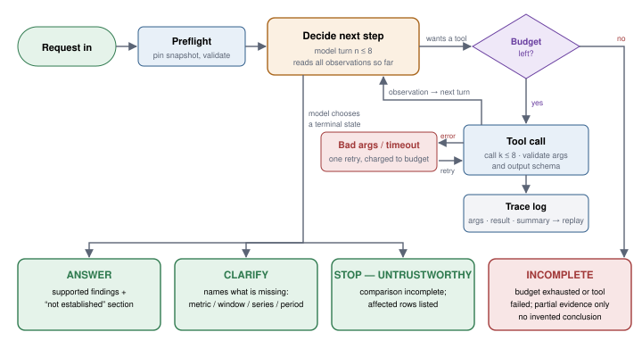

*Figure 4 · Agent loop. Retries count against the same 8-turn / 8-call budget. Asking for
clarification on a fully specified request is graded as a failure, and so is an invented
conclusion when the budget runs out.*

### Rules the harness enforces

- **No hints.** No tool returns a scenario label, a "correct next action", or anything
  derived from the hidden manifest.
- **No free-text numbers.** The model writes *pointer tokens* such as `{ev:cmp2.n_actual}`;
  the assembler replaces each with the value from a validated tool field. A plain digit
  search is not enough because series IDs (`CA_2`) and dates contain digits, so the
  validator strips known IDs and dates first and then rejects any digit left over.
- **Cited reasoning.** Each turn records `observation_refs`: at most two earlier call IDs its
  decision relied on. The cap stops the model citing everything; the field makes adaptive
  behaviour checkable by code.
- **Checkable clarification.** CLARIFY lists what is missing from a fixed set (`metric`,
  `window`, `series`, `period`) plus the options tool 1 returned. In offline runs CLARIFY
  ends the run.
- **Replayable.** The snapshot ID is pinned at preflight; every call is logged with
  arguments and a result hash, so any run replays offline with no model call.

**[SPECULATION]** 8 turns / 8 calls is a starting budget. Change it only from the
development-set pilot, and write the change in the decision log.

## 5. A worked example

**[SPECULATION]** An invented example on synthetic data. The request says one
store-category looks worse and asks whether the model needs investigating. The two cases
are a *matched pair*: same request text, same series, same windows. They differ only in
what the generator planted.

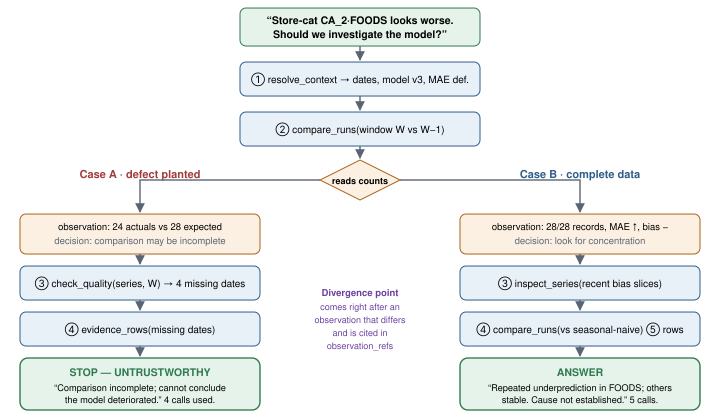

*Figure 5 · Two-path investigation. Series names and counts are illustrative. The agentic
work is the change in what gets checked (call ③ differs), not different wording in the
final answer. Case A shows stopping because of evidence; Case B shows following up because
of evidence.*

- A third valid outcome is CLARIFY, when "worse" could mean different metrics or periods.
  Asking on a fully specified request is still a failure.
- Controlled cases make behaviour testable. They say nothing about how often missing
  records or forecast shifts happen in a real business.
- This pair is exactly the weekend 3 kill-gate test (section 10). If the agent does not
  diverge here for evidence reasons, nothing else is built until it does.

## 6. Data

Version 1 runs entirely on self-generated *fixtures*. That removes two common stall
points — building a real data pipeline and checking a data licence — and gives the grader
exact ground truth for every *planted defect*.

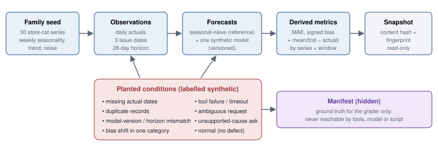

*Figure 6 · Fixture pipeline. One case-family seed produces a base snapshot; each variant
plants exactly one condition. Planted conditions are always labelled synthetic. Signed bias
is forecast minus actual, so negative means underprediction.*

### Two clocks that must never mix

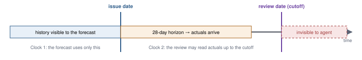

*Figure 7 · Leakage boundaries. Tools enforce both cutoffs in code.*

### Starting code in this repository

All code is written in notebooks under `nbs/`; the modules in `src/` are generated from
them (see [decision 0002](decisions/0002-notebooks-are-the-source.md)).

- `00_fixtures`: strict fixture loader, split at origin, seasonal-naive (extend from one
  series to many)
- `01_metrics`: validated MAE and signed bias
- `02_evidence`: evidence rows with stable row IDs
- `03_schemas`: contracts for cases, manifest, tool calls, trace and packets
- `04_sealing` and [sealing.md](sealing.md): `age` sealing of held-out case seeds
- `05_credentials`: OpenRouter key handling
- uv, nbdev, ruff, mypy `--strict`, pytest, CI

### Optional: real retail data (after weekend 7)

**[FINDING — background, 2020]** The M5 competition guide describes Walmart daily unit sales
across ten stores and three categories, with a 30-series store-category level.
Redistribution permission is unverified.

Only if access and licence are confirmed and everything else is done: at most 30
store-category series, seasonal-naive only, ship a preparation script rather than raw data.

## 7. Evaluation, part 1: a fair opponent and comparable inputs

**The baseline.** A reasonable Python report that calls the same five tool functions, with
conditional checks and templates. It is not deliberately weak. It is written and tagged
frozen in weekend 4, before any held-out case exists, so it cannot be tuned to the test
set.

**Resource parity.** The script has no call limit. Cheap exhaustive checking is a real
strength of ordinary code, and capping it to help the agent would make the comparison
dishonest. Defects are not designed to beat fixed rules either — that would be tuning the
test to the agent. The question is whether the agent matches an exhaustive script within 8
calls, and handles requests the script's templates cannot. The script's calls and runtime
are logged and reported.

**Comparable inputs.** A script cannot read free text, so each case carries two equivalent
forms of the same scope: `request_text` for the agent and `canonical_scope` for the script,
with empty fields where the request is ambiguous. Because the script sees ambiguity as
empty fields, it detects it for free. Ambiguous cases are therefore scored as their own
slice, measuring language understanding, and kept out of the paired comparison.

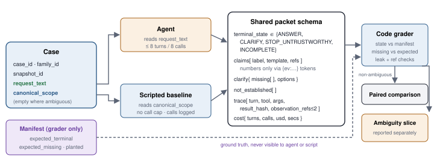

*Figure 8 · Case, packet and grading contracts. These schemas are the first thing written
(weekend 0+1). On empty scope fields the script also emits CLARIFY with the same `missing`
list, so both are scored the same way.*

**Analytical quality is not interaction convenience.** A script's lack of a chat interface
is not counted as an analytical error.

## 8. Evaluation, part 2: the investigation, not whether it sounds convincing

Cases are split into *development* and *held-out* sets by case family, before any variants
are made, and related variants stay together. Held-out seeds are sealed with `age` until
the baseline and the agent prompt are both frozen.

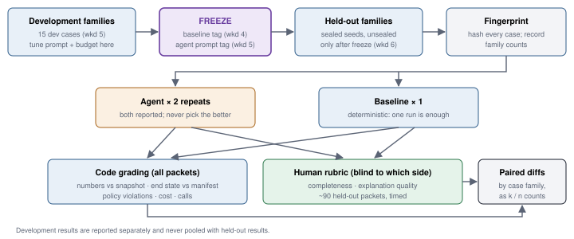

*Figure 9 · Evaluation pipeline and freeze order. The baseline is frozen before held-out
families are unsealed. Thirty cases and two repeats are not sixty independent observations;
case-family counts are disclosed.*

| Measure | Graded by | What it tells you |
|---|---|---|
| Complete task success (counts) | code + human | Investigation done, supported findings, needed coverage, correct answer / clarify / stop |
| Evidence correctness | code | Reported facts match the snapshot; a valid source alone does not prove the conclusion |
| Adaptive behaviour | code | Matched pairs diverge at an evidence-dependent step, checked through `observation_refs` |
| Ambiguity handling (own slice) | code | CLARIFY's `missing` set matches the manifest; unneeded CLARIFY fails |
| Failure and recovery | code | Timeouts, bad arguments and exhaustion handled honestly, not hidden |
| Time, cost, tool calls | code | Whether a useful result needed more resources than the script |

Failed runs, invalid output and incomplete answers stay in the main denominator;
infrastructure failures are also listed separately. The model never grades itself, and a
recheck by the same person is reported as such, not as independent annotation.

> **Grading-time rule.** Held-out packets to hand-grade = *n* × 3 (agent twice + baseline
> once) ≈ 90 at *n* = 30. In weekend 5, time the rubric on development packets (*m* minutes
> each). If 3*nm* > 600 minutes, set *n* = ⌊600 / 3*m*⌋, never below 20, and disclose it.

## 9. What you end up with

The main artifact is a *review packet*, not a chat transcript. Findings carry source-row
references, and code fills in every number. Correct numbers still don't guarantee a correct
or complete conclusion, which is why the human rubric exists.

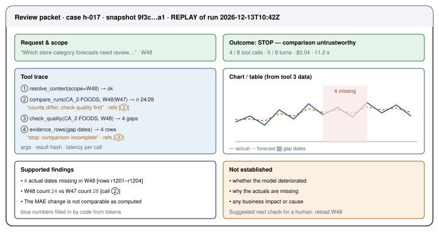

*Figure 10 · Packet layout (wireframe). Illustrative values only; no run exists yet.
Replays are always labelled as replays.*

**What the repository will let anyone do**

- Regenerate the fixtures and forecasts, run the scripted report, replay every saved agent
  case and inspect the evaluation — all with no paid model calls.
- See at least one informative failure next to the successes.
- Run live only locally or authenticated, with a spending limit. A public demo replays saved
  real runs; there is no open paid endpoint.

**The write-up, in this order:** the review task → the simpler alternative → what the agent
is allowed to decide → one success → one failure → the measured comparison → what you
would not claim. Resume bullets report real counts and trade-offs only.

## 10. Schedule, gates and limits

The foundation (schemas, data, tools, grader) comes first because everything else stands on
it. The kill gate sits before any further investment, and real data is a reward for
finishing, not a prerequisite for starting.

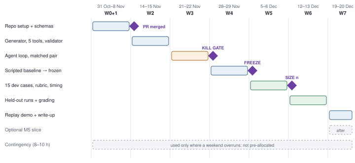

*Figure 11 · Weekend roadmap. Purple diamonds are go / no-go points. Nothing after weekend 3
starts until the gate result is written in the decision log.*

| When | Deliverable | Hours | Done when |
|---|---|---|---|
| W0+1 (31 Oct–8 Nov) | Repository setup; scope decision record; tool, case, turn and packet schemas (Figure 8) | 8–10 | Schemas PR merged; CI green |
| W2 (14–15 Nov) | Fixture generator with planted defects and manifest; five typed read-only tools; validator including the stray-digit check; unit tests | 10–12 | Tools return correct values on fixtures |
| W3 (21–22 Nov) | ADK loop over OpenRouter on fixtures; 8 / 8 budget; trace and replay file; the matched pair from section 5 | 8–10 | **Kill gate** passed |
| W4 (28–29 Nov) | Scripted baseline on the same tools; git tag `baseline-frozen`; held-out seeds generated and sealed | 6–8 | Tag exists before seeds are unsealed |
| W5 (5–6 Dec) | 15 development cases across all conditions; rubric; timed grading pilot; tag the agent prompt | 8–10 | Held-out *n* set by the grading rule |
| W6 (12–13 Dec) | Unseal held-out families; fingerprint; run agent twice and baseline once; grade | 10–12 | All packets graded |
| W7 (19–20 Dec) | Replay demo; write-up including one real failure; final README | 8–10 | A stranger can rerun it offline |
| **Total** | Plus 8–10 h contingency; ceiling about 82 h | **58–72** | |

**[SPECULATION]** Hour estimates assume the familiar Python and ADK stack and are not
commitments.

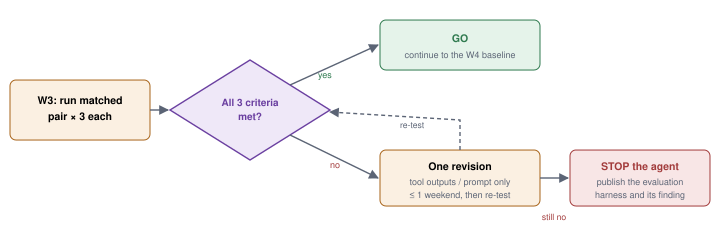

*Figure 12 · Kill-gate decision. Failing does not waste the work: the schemas, generator,
tools, validator and grader still make a publishable evaluation harness, and "the agent did
not adapt" is itself a reportable finding.*

### Kill-gate criteria (weekend 3)

1. **Divergence:** in at least 2 of 3 runs per case, the two matched cases produce different
   tool sequences.
2. **For evidence reasons:** the first differing call comes right after the first
   observation whose result hash differs between the cases, and that turn's
   `observation_refs` include it. Checked by code.
3. **Correct exits:** Case A ends STOP — UNTRUSTWORTHY and Case B ends ANSWER, with no
   invented cause.

Sanity check: confirm no tool output carries a scenario label. A pass caused by a leaked
hint counts as a fail.

### Cadence

- Every weekend ends with something that runs: a merged PR, a passing test, or a saved
  trace.
- A weekend that slips moves the whole chain right; it never squeezes the next one.
- No re-planning before 30 Nov. New ideas go to a parking-lot file. Already parked: a
  call-budgeted script variant; simulated replies that let a run continue after CLARIFY.
- If the remaining estimate passes about 100 hours, that is a scope change, not "one small
  feature".

### Budget and cut order

- **[SPECULATION]** $60 total model cap, $15 optional hosting cap. Stop or shrink if the
  weekend 5 pilot shows they are not enough.
- Cut first: hosting, real data, model sophistication, polish.
- Never cut: the credible baseline, the freeze order, leakage controls, failure evaluation.

### Not in version 1

Multiple agents, automatic training or promotion, inventory actions, new forecasting models
(e.g. LightGBM), document search, long-term memory, fine-tuning, model routing,
production-scale serving claims.

## Glossary

| Term | Meaning |
|---|---|
| MAE | Mean absolute error: the average size of forecast misses, ignoring direction. |
| Signed bias | Average of forecast minus actual. Negative means the forecast was too low. |
| Store-category series | Daily sales for one category in one store; 30 such series in the fixtures. |
| Issue date, horizon | When a forecast is made, and how far ahead it covers (28 days). |
| Review date | The cutoff for the investigation; nothing after it is visible. |
| Snapshot, fingerprint | A frozen, versioned copy of all data, and the content hash that identifies it. |
| Fixture | Self-generated test data with known properties. |
| Planted defect | A condition deliberately added to a fixture (missing dates, duplicates, a mismatch, a bias shift). |
| Manifest | The hidden record of what was planted in each case; only the grader reads it. |
| Case family | One seed and all its variants. Families never straddle development and held-out. |
| Matched pair | Two cases identical except for one planted condition. |
| Development / held-out | Cases used for tuning vs. cases kept sealed until everything is frozen. |
| Typed tool | A function whose arguments and outputs have a format checked by code. |
| Terminal state | How a run ends: ANSWER, CLARIFY, STOP — UNTRUSTWORTHY, or INCOMPLETE. |
| Pointer token | A placeholder such as `{ev:cmp2.n_actual}` that code replaces with a validated value. |
| `observation_refs` | The (at most two) earlier tool calls a turn says its decision relied on. |
| Review packet | The output: end state, findings with source rows, unknowns, trace and cost. |
| Scripted baseline | The rule-based Python report the agent is compared with. |
| Kill gate | The weekend 3 test that decides whether the agent idea is worth continuing. |
| Replay | Re-running a saved trace offline, with no model call. |
| ADK, OpenRouter | Google's agent framework; a service routing calls to many hosted models. |
| `age` sealing | Encrypting held-out seeds so they can't be looked at early. |

## References

**[FINDING]** Sources were read on 31 Oct 2026; their reported results were not reproduced.

| Source | Date | What this project takes from it |
|---|---|---|
| Databricks: AI incident investigation | 24 Aug 2026 | Deterministic checks inside a bounded investigation; evidence-linked conclusions |
| Netflix: Pensive AI | 26 Oct 2026 | Rebuilding shown text from sources; saved evaluation inputs |
| Uber: Cart Assistant | 16 Jun 2026 | Ambiguity to the model; pricing and validation in code |
| Hamel Husain: verification-first design | 29 Jun 2026 | Show assumptions, queries, results and what could not be verified |
| Apple: Agent Harness job posting | 8 Oct 2026 | Named skills: agent loops, tool execution, tracing, replay, evals |
| Google ADK: LLM agents | undated docs | Dynamic tool choice is nondeterministic and needs evaluation |
| M5 competitors' guide | 2020 | Shape of the optional real data only |

## Open questions, each with a weekend

| Question | Settled in | How |
|---|---|---|
| Exact field names in the schemas | W0+1 | Schemas PR |
| Does the agent adapt to evidence? | W3 | Kill gate |
| Rubric wording; minutes per packet; held-out *n* | W5 | Timed pilot and the grading rule |
| Model choice and measured cost | W5 | Pin in config; record in the decision log |
| Real-data access and publication rights | after W7 | Only if doing the optional slice |
